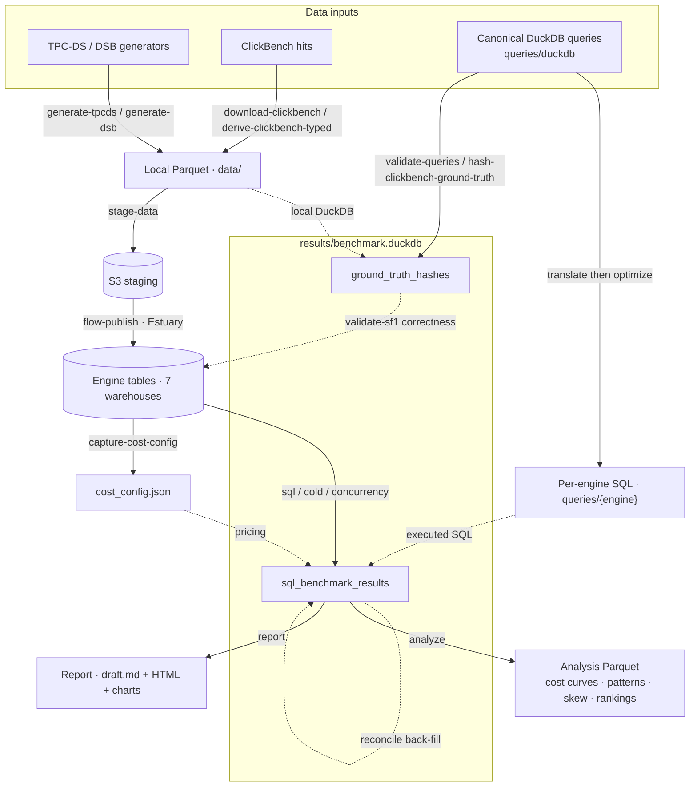

# Architecture: How the Harness Works

> **This document describes the codebase as it is**, derived by reading
> the source.
>
> Audience: anyone trying to understand or modify the harness. For *operating* a
> benchmark run, see `OPERATOR_GUIDE.md`. For the full
> end-to-end loading flow, see [`E2E_LOADING.md`](E2E_LOADING.md).

---

## Data flow at a glance

The benchmark is, at heart, a set of **commands that move and transform data**: from
generators and public datasets into one results database and a report. The diagram shows
that flow: **data inputs -> the commands acting on them -> outputs.** It is deliberately
*not* control flow or stage sequencing (for run order, see "Pipeline stages" in
`.claude/CLAUDE.md`).

**Legend.** Nodes are data: files, S3, engine tables, results-DB tables. **Solid arrow**
= artifact produced by the labeled `benchmark` command; **dotted arrow** = artifact
consumed by / informing the target (no new artifact). The report reads the
results DB directly; it does **not** consume the analysis Parquet.

---

## 1. What the project is

A reproducible benchmark comparing **7 cloud warehouse engines** (Snowflake,
Databricks, BigQuery, Redshift Serverless, Microsoft Fabric, ClickHouse Cloud,
MotherDuck) on **244 SQL queries** (TPC-DS 99 + DSB 102 + ClickBench 43). The
central question is **how latency and cost scale as a function of the warehouse
(engine + compute size) and the workload type**: warm/cold/concurrency passes
across SF1–SF1000, compute-size sweeps per engine, and cost with confidence tiers.
Every experiment measures cost, latency, and quality.

The work runs as an ordered pipeline (query suite -> data generation -> infra ->
loading -> translation -> SQL benchmark -> reconcile and analysis -> report); the
commands per stage are listed under "Pipeline stages" in `.claude/CLAUDE.md`.

## 2. The harness is a CLI, not an orchestrator class

There is no orchestrator module or class. All orchestration lives in the Typer CLI
(`src/benchmark/cli.py`): each command loops over platforms/blocks itself and calls
function-based modules under `src/benchmark/`. When you see "the orchestrator" in
docstrings, it means the CLI command layer.

Entry points:
- `uv run benchmark <cmd>` -> `src/benchmark/__main__.py` -> `cli.app`
- `uv run settings <cmd>` -> `src/benchmark/cli_settings.py` (a **separate** Typer
  app for typed-config inspection, not part of `benchmark`)

## 3. CLI command surface (what each command does)

Grouped by pipeline stage. Read the "does" column carefully: several names mislead.

Every command that takes `--platforms` resolves it through `cli._resolve_platforms`:
a comma list of engine ids (run in the order given) or `all`, the seven engines in
canonical order (`connectors.registry.ALL_PLATFORMS`: snowflake, databricks,
bigquery, redshift, fabric, clickhouse, motherduck). A command that acts on only
some engines narrows `all` by its own rule: `reconcile` keeps the engines with a
reconciler (`analysis.reconcile.RECONCILERS`, every engine but ClickHouse). An
unknown name is a usage error (exit 2) with a "did you mean" hint, raised before
anything runs. `optimize` takes `--platform` (one engine, or `all`).

### Query suite & datasets
| Command | Does |
|---|---|
| `validate-queries` | **Misnomer: does NOT validate.** Hashes the canonical DuckDB queries locally and *writes ground truth* into `ground_truth_hashes`. |
| `validate-dialects` | The dialect gate: in-memory sqlglot translation of all 244 to each dialect; exits 1 if any engine is below `--threshold`. No files written. |

### Data generation & staging
| Command | Does |
|---|---|
| `generate-tpcds` | TPC-DS Parquet via the **DuckDB `tpcds` extension** (not upstream `dsdgen`); writes `expected_counts.json`. |
| `generate-dsb` | Always rebuilds the 102 DSB query files; generates **real skewed** DSB data unless `--queries-only`. **Serial only**, both dsdgen parallelism avenues are broken in the microsoft/dsb fork (probed live: `-PARALLEL`'s `-CHILD >= 2` SIGSEGVs at every N/scale; `-TABLE` SIGSEGVs on the sales parents even solo, see the note in `datagen/dsb.py`). Budget several hours for SF1000 raw generation. |
| `download-clickbench` | Resumable Range download of the upstream `hits.parquet` (~14 GiB) to `data/clickbench/hits.parquet.raw`. |
| `derive-clickbench-typed` | Derives typed `hits.parquet` (Date32 + ISO-8601 strings) from raw. |
| `hash-clickbench-ground-truth` | Hashes the 43 ClickBench queries into `ground_truth_hashes`, **keyed SF100**. |
| `stage-data` | Uploads Parquet to S3 per suite. |
| `generate-checksums` / `generate-expected-counts` | SHA-256 manifest / row-count manifest. `generate-expected-counts` merges (never clobbers other scales); `--from-s3 --suite <s> --scales <N>` derives counts from staged S3 parquet **footers** (range reads) to backfill a scale generated elsewhere. |

### Infra & readiness
| Command | Does |
|---|---|
| `connectivity-check` | Opens each connector, runs `SELECT 1`, prints OK/FAIL/SKIP. The probes run in parallel with a shared `--timeout` (default 30 s), so an engine whose host no longer answers is reported as failed instead of stalling the check. |
| `prepare-scale` | **Read-only readiness gate** for a scale: checks data-loaded + compute-sized per platform, writes `terraform/sizing.auto.tfvars.json` (never runs apply), prints manual/data-gap steps. Also validates the **upstream sources** per suite (shared across engines, reported once): the staged **S3** parquet-footer counts vs the manifest (`--check-s3`), which combined with the data axis (DB vs manifest) asserts **S3 == DB** end-to-end, and the **Estuary collections** presence + non-empty + freshness (`--check-estuary`). Both skipped under `--compute-only`; S3 needs the Estuary S3 keys, Estuary needs flowctl auth (each degrades to `unreachable` independently). |
| `capture-cost-config` | Introspects each engine's cost driver -> `results/cost_config.json`, merged into an existing file (§7). `sql`, `cold`, `concurrency` and `sustained` exit 2 without the file. |
| `export-terraform-outputs` | `terraform output -json` -> file the harness reads later; also materializes the terraform-managed GCP SA-key files to the paths the connectors read (`BIGQUERY_GCP_SA_KEY`, `ESTUARY_BIGQUERY_SERVICE_ACCOUNT_KEY`, `0600`) so there's no manual "decode + drop the key file" step (`--no-materialize-keys` to skip). |

### Loading via Estuary (flowctl wrappers)
| Command | Does |
|---|---|
| `flow-auth` / `flow-render` / `flow-publish` / `flow-delete` | Authenticate / `${VAR}`-substitute+preview / substitute+publish / delete Estuary specs. Auth is carried per-call via `FLOW_AUTH_TOKEN` (an Estuary **refresh** token, long-lived), not `flowctl auth token`. `flow-publish` defaults to the full spec but accepts `--materializations`/`--scale`/`--suites` to publish a **scoped subset**, and `--backfill N` to bump those bindings' backfill counter (targeted re-backfill of one scale/suite without re-touching others, e.g. one engine's tpcds+dsb at SF1). Spec aliases resolve to files under `estuary/`: `source-s3` + the seven engine names (production `benchmark/` pipeline), and `sf1000-captures` (SF1000 ingest split across 24 LPT-packed capture tasks for parallel backfill, the sf1000 bindings are deliberately absent from `source-s3` and must never be re-added there; see the spec header). Typed collection schemas are injected for every namespace a capture's targets use, so every collection gets native columns. |
| `flow-disable` | Pauses the scope-matching materializations of an engine's spec (`shards.disable: true`, no backfill bump, loaded data kept), or resumes them with `--enable`. Run it after `validate-loads` passes and before any measured run on that warehouse: a live materialization keeps committing to the warehouse being measured and shares the billing hour reconcile splits. Only tasks Estuary already holds are published (a scoped publish of a missing name would create it); a scope filter is required. (`staging/estuary.py:set_materializations_disabled`) |
| `flow-reset` | Scoped Estuary **data-flow reset**: publishes the scope-matching collections of a capture spec with `reset: true`, so Estuary regenerates each journal and auto-bumps the backfill counters on the capture binding and every subscribing materialization binding (docs.estuary.dev/reference/backfilling-data). Use when the **capture** must re-read S3 (e.g. after a capture-runtime change like `enable-runtime-v2`); `flow-publish --backfill` only re-reads the *existing* journal. A scope filter (`--suites`/`--scale`/`--tables`) is mandatory, collections are shared upstream of all 7 engines, so a reset truncates and reloads the matching destination tables on **every** engine. `--dry-run` lists the match. (`cli.py`, `staging/estuary.py:reset_collections`) |
| `flow-metrics` | Pipeline-side task telemetry from Estuary's **OpenMetrics API** (docs.estuary.dev/reference/openmetrics-api): `captured_out_docs_total` / `materialized_out_docs_total` per task × collection, i.e. documents the pipeline itself has moved, no destination-warehouse connection needed. `--task`/`--collection` substring filters, `--prefix` (default `ESTUARY_ACCOUNT`), `--watch N` for a live-refreshing table with docs/s deltas (Estuary recommends ≥60s). Auth reuses `ESTUARY_REFRESH_TOKEN` as a Bearer token against `ESTUARY_OPENMETRICS_URL`. Complements `validate-loads` (destination-side counts) during backfills. (`cli.py`, `staging/estuary_metrics.py`) |
| `flow-publish-motherduck` | Auth + publish the 2 MotherDuck pipeline specs. |
| `clickhouse-prepare-databases` | `CREATE DATABASE IF NOT EXISTS` for each CH materialization DB. |
| `load-motherduck-local` | Direct local-parquet->MotherDuck load of the TPC-DS tables (`--data-dir`, default `data/tpcds/sf1`, into `benchmark_db.<--schema>`), **bypassing Estuary** (creds-not-wired fast path). |
| `validate-loads` | Row-count check vs `expected_counts.json`; can poll for async backfill. |

**Loading while measuring (Databricks).** Every Databricks materialization writes through `DATABRICKS_LOADER_SQL_HTTP_PATH`, which defaults to the benchmark warehouse (`DATABRICKS_SQL_HTTP_PATH`). Pointing it at a second SQL warehouse keeps a long load's commit rounds off the warehouse being measured, so scales that are already loaded can be measured while a larger one loads (their own materializations paused with `flow-disable`). `validate-loads` counts through the benchmark warehouse (`DATABRICKS_SQL_HTTP_PATH`; the env files win over the process environment, so the path cannot be overridden per process), so do not run it during a measurement: follow a load with Estuary's metrics (`flow-metrics`), which touch no warehouse, and count once the measurement is over. At SF1000 the four fact tables have their own materializations (store sales, catalog sales, web sales with inventory), as the Redshift spec does: one task is one sequential pipeline, and an unsplit task at SF1000 can run for more than four hours before it reaches `store_sales`.

### Translation, optimization, physical design
| Command | Does |
|---|---|
| `translate` | sqlglot DuckDB->dialect for each engine in `--platforms` (default `motherduck`) × all 244 queries, plus regex/AST post-patches; writes `queries/<engine>/<block>/` for **every** block and `results/translation_matrix.json`. The committed per-engine files are not pure translator output, so a re-run overwrites SQL it would not regenerate: the ClickBench project's 43 files on each of Snowflake, Databricks, BigQuery, Redshift and ClickHouse (§6), Fabric's hand-maintained ClickBench q29, and about 50 TPC-DS/DSB files with hand-applied correctness patches. Translate one named engine and review the `queries/` diff. |
| `optimize` | Per-engine Claude SQL rewrite pass, **equivalence-gated**; `--platform` (one engine, or `all`); `--via claude-cli` (default) or `sdk`; default model `claude-opus-4-8`; resume journal; overwrites files in place; `validate-sf1 --revert-on-regression` reverts rewrites that regress on the engine. |
| `design-physical` / `apply-physical-design` | Emit physical-design spec JSON / apply clustering/dist/stats to loaded tables. |
| `validate-correctness` | **The real correctness check.** Runs each query in the engine's dialect (`queries/<engine>/`, what the benchmark executes) once and compares to `ground_truth_hashes` at `--scale` (default 1); exits 1 on failures. `--platforms` defaults to `motherduck`, `--blocks` to all three. TPC-DS/DSB hit `<suite>_sf{scale}`; **ClickBench stays pinned to SF100** because that is where its ground truth is keyed, regardless of run tier. `--revert-on-regression` is refused above SF1, the optimize baselines were equivalence-gated at SF1, so a divergence at another scale is not evidence about the rewrite. Ground truth must exist at the same scale first (`validate-queries --scale N`). ClickBench is special-cased, the ClickBench project's per-engine queries are trusted (run, not compared) and only Fabric is validated; see §6 *ClickBench: the ClickBench project's per-engine queries, trusted vs validated*. |
| `validate-sf1` | Alias for `validate-correctness --scale 1`: the translation-stage gate that blocks the pipeline, under the name the README and `.claude/CLAUDE.md` use. Scales above 1 are a **spot check**, not a gate: the report's weakest claim is that correctness is verified at ~1 GB only. |

### SQL benchmark
| Command | Does |
|---|---|
| `sql` | Warm pass per platform × block: `--warmups` (default 1) unrecorded runs, then `--runs` (default 3) measured; `--blocks` defaults to `tpcds,dsb`, `--platforms` to `motherduck`; `--run-type` (default `warm`) is the label the rows carry (the cold, concurrency and sustained passes are their own commands). Exits 2 without `results/cost_config.json`. `--compute-size` sweeps one scale across sizes (Snowflake warehouse tier / BigQuery reservation slot count; see §10). |
| `bq-reservation` | Manage the BigQuery Enterprise slot reservation out-of-band: `--slots N` create/resize to a fixed baseline, `--teardown` delete to stop billing. Brackets a slot sweep. |
| `cold` | Cold pass (default SF1000), per-engine cache flush, single run, no correctness check. |
| `concurrency` | Concurrency pass (default SF100, `--blocks tpcds,dsb`) across `--levels` (1,5,10,20,50,100); `--compute-size` sweeps Snowflake warehouse bands (size-aware, labeled per band; ignored on other engines); `--tag` stamps `metadata.tag` on every row so replicate passes of one cell (e.g. `cold-r1`, `warm-r1`) stay distinguishable after latest-wins collapses them in the views. When the pass ends, its Fabric, ClickHouse, MotherDuck and Snowflake rows are window-priced and BigQuery reservation rows priced on the baseline held (offline; §7), since the inline cost charges each query the whole compute. Exits 2 without `results/cost_config.json`. |
| `sustained` | Sustained load: holds `--sessions` sessions busy cycling through the suite for `--minutes` (defaults 50 and 30, `--blocks tpcds`). Records run type `sustained` (`results.SUSTAINED_RUN_TYPE`), one `run_number` per pass through the suite, `metadata.submitted_s` per query (`--tag` as for `concurrency`); kept out of every burst figure and read through the `sustained_results` view. Size the compute out-of-band first. Window-priced at the end, as for `concurrency`. Exits 2 without `results/cost_config.json`. |
| `skip-scale` | Mark/un-mark a deliberate omission in `scale_skips`, keyed (scale × platform × **block** × **compute size** × **run type**); `--scale` required, `--blocks`, `--compute-size` and `--run-type` default to `*` (all). Block granularity exists because skips are often per-suite (a run plan may skip DSB at 1 TB while TPC-DS runs there), compute size because omissions are often per size (Redshift 8/16 RPU at 1 TB), and run type because a size can be out of scope single-user and measured under load (those same Redshift bands ran the 1 TB concurrency grid until it ejected them). `--unmark` deletes the row with exactly that key. Databases created before each column migrate in place on connect (`ResultsDB._migrate_scale_skips`, `_migrate_scale_skips_compute`, `_migrate_scale_skips_run_type`; transactional; existing rows take `'*'`). The report renders recorded skips as `(out of scope)` rather than with a completion ratio (single-user tables count only skips at run type `warm` or `*`), lists them with their run type under "Deliberately not measured", and `analyze` exports them for the explorer (`scale_skips.parquet`). |
| `coverage-audit` | Compares each engine's ladders against the results DB and prints every gap with the command that would fill it (`analysis/coverage.py`; `--kinds` filters, `--strict` exits 1 on any gap). Expected coverage is every size on the engine's single-user ladder (`run_plan.yaml` `sweep`) and under-load ladder (`load_sweep`, else `sweep`; ClickHouse runs load on three replicas) at every scale the plan covers, for TPC-DS and DSB, plus ClickBench at each size (its scale tags pooled), plus the designated size per scale, minus the recorded skips, which match on every key they carry (for ClickBench, a skip recorded for ClickBench, or an every-suite skip at one of the platform's ClickBench scale tags). Kinds: `designated-missing`, `sweep-hole` (single-user), `load-hole` (under load), `censored` (useful concurrency at the highest level tried), `level-gap` (protocol levels missing, for decision-support shapes and for every ClickBench size that ran under load; levels above a last level that had timeouts are ejected by rule, not a gap), `short-level` and `short-pass` (a level or single-user pass that recorded fewer queries than its suite). |
| `status` | Coverage matrix from `sql_benchmark_results`. |

> SF1000 is the maximum scale.

### Reconcile, analysis & report
| Command | Does |
|---|---|
| `reconcile` | One cell by default (`--scale 1000 --run-type warm`); `--all-cells` visits every (scale, run type) cell that still has unreconciled rows. `--platforms` defaults to Snowflake, Databricks, Redshift, Fabric and MotherDuck; add `bigquery` for its queue time, or pass `all` for every engine with a reconciler (all but ClickHouse, which records its metrics inline). Post-run back-fill of authoritative server-time + reconciled cost (Snowflake/Databricks/Redshift/Fabric), plus **MotherDuck server-time** (batch lookup from the durable `MD_QUERY_HISTORY()`: the connector captures only the query id inline; MotherDuck cost stays estimated), plus **queue time** (`queue_ms`) on the three engines whose server time is execution only: Databricks (`system.query.history`, one-year history), BigQuery (`INFORMATION_SCHEMA.JOBS_BY_PROJECT`, `start_time - creation_time`, 180 days) and Redshift (`SYS_QUERY_HISTORY.queue_time`, **7 days**, so reconcile a Redshift run within a week). A row on those engines stays a candidate until its queue time lands, so re-running `reconcile` back-fills rows reconciled without it. Databricks reconcile finds each statement's warehouse in `system.query.history` rather than using the connected one, and batches the ids (2,000 per query), so a warehouse in a recreated workspace in the same region can reconcile statements a deleted workspace ran. **Fabric** back-fills each statement's CPU time and span (`metadata.cpu_ms`, `start_time`, `end_time`) from `queryinsights` (30 days; the capacity must be Active), keeps a row without CPU time a candidate while that history lasts, and then re-prices the cell's capacity windows (see §7); it prices nothing per statement. The server-time, cost and queue-time paths have all run against live engines. |
| `recost-capacity` | Re-prices compute by the time queries held it (engine time; a window is a stretch in which a query ran), offline (no engine), on the engines that bill compute while it runs (§7): **Fabric** (SKU time plus bursting per burst, sustained hold or warm statement, split by CPU share, or elapsed share where CPU time is gone), **ClickHouse** and **MotherDuck**'s per-second Ducklings (warm rows at the size's rate × engine time; shared load at the rate × each window, split by engine time; Pulse keeps its per-query price), **Databricks** (each billed hour's share split across the hour's windows by list rate × time and capped at it, then by execution time), **Redshift** (billed share capped at RPU rate × each window's time), **BigQuery** reservations (baseline slots × rate × each window's time) and **Snowflake** (like ClickHouse: list rate × engine time at Standard edition, windows under load; attribution credits kept as a cross-check). `reconcile`, `sql`, `cold` and the `concurrency` / `sustained` commands do this for what they touch; this re-prices everything. `--platforms` picks engines (default and `all`: all seven); idempotent; `--dry-run` prints the before/after totals. |
| `analyze` | Emits Parquet: cost curves, ClickBench summary, concurrency grid, patterns (warm and under-load), rankings, skew (warm and under-load), MotherDuck cost, cross-engine row-count agreement, and four for the explorer: the size ladder, the rate card, the query catalog and the recorded skips (`scale_skips.parquet`: one row per `scale_skips` row with every key, the reason and `skipped_on` as a date string; `analysis/scale_skips.py`). `size_ladder.parquet` is the warm pass at **every** compute size (one row per platform, block, scale, compute size and query: median server time and mean cost over successful runs, plus run and failure counts and the first and last run timestamps), read from `results_latest` with the single-replica ClickHouse predicate; ClickBench rows carry `scale_factor` NULL (the campaign tags are pooled, as `generator._scale_expr` pools them). Summed over the queries every size at a (platform, scale) completed, it reproduces `verifiers._ladder_common_complete` exactly (committed-DB integration test). `rate_card.parquet` is `report/compute_rates.effective_usd_per_hour` applied to every `compute_label` in the results, with its billing unit (NULL rate for BigQuery on-demand). `query_catalog.parquet` is one row per canonical query from `QueryRegistry` (suite, number, pattern tags, the repo path of its SQL with `{platform}` standing for the dialect directory, and `returns_pair`, which marks both sides of the TPC-DS/DSB pairs whose SQL reads a `*_returns` table: `report/verifiers.returns_qnums`, the report's skew split, so the explorer quotes the report's clean-pair skew medians). `concurrency_grid.parquet` is per (workload, platform, scale, compute size, level), the per-level data behind `analysis/concurrency_shape.py`, carrying that module's SLA-**independent** per-cell constants (`k`, `failure_mode`, `shed_pct_at_max`, `solo_latency_ms`, `publishable`, `withheld_reason`) plus `usd_per_hour` from `report/compute_rates.py`. Latency is **engine time**: the engine's time on a query with its own queue wait included and the network excluded (`engine_ms` in the `concurrency_results` view, `concurrency_shape.engine_ms_sql`; server time plus `queue_ms`, and `compile_ms` on Databricks, for the execution-only engines Databricks, Redshift and BigQuery). A level where under 95% of successful rows carry engine time has `p50_ms` NULL, and a cell with any such level is withheld (every `p50_ms` NULL, `publishable` false, `withheld_reason` "engine time not captured"). `server_p50_ms` keeps the engine-reported median for comparison and `engine_time_pct` the coverage. Failures are classified (`concurrency_shape.failure_class_sql`): `shed_pct` is the share not completed, split into `timeout_pct` (our timeout or client cancel), `connection_pct` (dropped under a running query) and `engine_error_pct`; rows the harness itself failed (sent into a lost session, or into a session reaped while idle, "Broken pipe") are left out of every figure, `runs` included. The SLA-**dependent** metric is left to the consumer: `max(concurrency) FILTER (WHERE p50_ms <= S AND shed_pct < sla_max_shed_pct)` reproduces `shapes(sla_ms=S).useful_concurrency` exactly (`tests/integration/test_committed_results_db.py` checks every cell of both workloads), so a reader can re-target the SLA without re-running the reducer. Reads `results_latest`, NOT `bench`: the ladder sweeps compute sizes on purpose, so the designated-tier restriction must not apply. `workload` is `decision_support` (TPC-DS + DSB pooled per platform, scale and compute size) or `clickbench`; ClickBench cells pool the campaign scale tags (the `hits` table does not change size between them, so `scale_factor` is NULL and a cell is one platform and compute size), use a 40-row level floor (one 43-query pass) in place of the decision-support 50, and keep the protocol levels (1/5/10/20/50/100) through 50, leaving out level 40 (off the protocol ladder) and the 100-session level: a level queues the suite's 43 queries once, so 50 and 100 sessions both run at most 43 at once, and the 57 idle connections at 100 add connection failures (Fabric) and timeouts (Snowflake) that are not query load; the explorer labels the 50-session level 43 (`analysis/concurrency_grid.py:CLICKBENCH`; `shapes()` takes the same cut, and the committed-DB integration tests hold the two together per workload). `pattern_load.parquet` asks `patterns.py`'s question ("where does engine X shine vs struggle?") of the concurrency grid instead of the warm pass, per (platform, scale, compute size, level, pattern). It emits both `pattern_ms` and `cell_ms` (the engine's median over ALL queries in the same cell) so the consumer can normalize: their ratio is scoped inside one engine-and-size, dividing out raw engine speed and warehouse size, which is what makes the ratio safe to pool across compute sizes when a raw latency would not be. `skew_load.parquet` asks `skew.py`'s question ("what does data skew cost?") of the concurrency grid, per (platform, scale, compute size, level): `skew_ratio` is the median over paired query numbers (`dsb_qNN` / `tpcds_qNN`, each side that query's median in the cell) of the DSB-over-TPC-DS server-time ratio, with `pairs` counting the query numbers measured on both sides; cells with fewer than 20 pairs are dropped. Formed per query and per cell, the ratio divides out engine speed, warehouse size and the level's queueing, so it is comparable across cells. `clickbench_summary.parquet` is per (platform, query); its `compute_tag` column is the campaign tag, which for ClickBench varies **compute tier**, not data volume (one fixed ~100 GB `hits` dataset), so each row carries `compute_label` and an `is_entry_tier` flag marking each engine's entry tier (its lowest campaign tag in the designated-tier population; not always its smallest size, since the size sweeps in `size_ladder.parquet` ran smaller sizes for BigQuery, ClickHouse, Databricks and MotherDuck), the only slice on which all seven engines compare without averaging across warehouse sizes. The columns and types of the eleven exports the explorer reads are its contract with `analyze`: `viz/scripts/export-schema.json` records them, `tests/integration/test_explorer_export_contract.py` fails when an export drops, renames or retypes one, and the explorer's build refuses to build (a new column is not a failure; see `viz/README.md`). |
| `verify-figures` | **Number-drift gate.** Recomputes every `<!-- verify: name -->` table in `report/sections/*.md` from the results DB and exits 1 if a published number disagrees. `--tolerance` (default 1%), `--strict` also fails on coverage findings. See §10. |
| `report` | Regenerates `report/draft.md` + charts + HTML. |
| `render-status` | Renders a status page from an HTML template you supply, resolving its `{{fact:...}}` placeholders against the results DB (`report/narrative.resolve_facts`; the facts it can name are the keys of `narrative.FACTS`, and an unresolvable one is an error); writes `benchmark-status-<date>.html` beside the template unless `--output`. `--template` is required (the repository ships no template) and a path that is not a file exits 2. |
| `e2e` | Thin driver (`e2e.py`) that shells, in order: generate (TPC-DS, DSB; ClickBench download + derive) -> ground truth -> checksums + expected counts -> `stage-data` -> `flow-publish source-s3` -> each engine's materialization -> `validate-loads --wait` -> `capture-cost-config` -> `sql` per engine -> `analyze` -> `report`. The `capture-cost-config` step (key `cost-config`) is skipped when `results/cost_config.json` exists, unless `--recapture-cost-config` (the capture merges into the file). It does not run `translate`, `validate-sf1`, `flow-disable` or the SF1000 split captures. `--from` / `--skip` take step keys; it stops at the first failed step unless `--keep-going`. |

## 4. Module map (`src/benchmark/`)

| Path | Role |
|---|---|
| `cli.py` / `__main__.py` | All commands; entry point. |
| `cli_settings.py` / `settings.py` | `uv run settings`; typed `pydantic-settings` tree (`get_settings()`). All env access flows through this. |
| `results.py` | DuckDB results DB (`results/benchmark.duckdb`): schema + read/write. |
| `translator.py` | sqlglot translation + per-engine post-patches (regex + 2 AST passes). |
| `optimize_pass.py` | Claude per-engine SQL optimization; `claude-cli` (default) or `sdk` backend; equivalence-gated; resume journal. |
| `equivalence.py` | Local execute-and-compare equivalence gate (transpile rewrite -> DuckDB -> compare) + arity tripwire, used by `optimize`. |
| `physical_design.py` | Clustering/dist/sort/stats spec + per-engine appliers. |
| `scales.py` / `run_plan.py` (+ `run_plan.yaml`) / `prepare_scale.py` / `scale_manifest.py` | **Per-scale readiness/provisioning layer** (compute sizing matrix, readiness gate, manifest). `run_plan.yaml` also declares each engine's size ladder: `sweep` (single-user) and, where it differs, `load_sweep` (the concurrency grid; ClickHouse `3x8GB`..`3x120GB`), read by `RunPlan.sweep_ladder` / `load_ladder` and by `coverage-audit`. |
| `e2e.py` | Ordered full-pipeline driver (shells subcommands). |
| `provenance.py` | Run provenance for the `benchmark_run` table (§7). |
| `terraform_outputs.py` | Reads exported `terraform output -json`; feeds `engine_environment`; writes the terraform-managed SA-key files. |
| `exceptions.py` / `logging_config.py` | Exception hierarchy; Rich console + JSON audit logging (no `print()`). The audit file also takes INFO from the library loggers in `AUDITED_LIBRARY_LOGGERS` (the Databricks connector's retry logger, which is where a throttled HTTP 429/503 submit is recorded), without echoing them to the console. |
| `connectors/` | One `WarehouseConnector` per engine + `base.py`, `registry.py` (connector factory and `ALL_PLATFORMS`, the canonical engine order `--platforms all` expands to), `connection.py` (connect/reconnect with retry). Context-manager based. |
| `cost/` | Per-engine cost collectors + `base.py`, `registry.py`, `discovery.py`. |
| `compute/` | `bigquery_reservation.py`: the out-of-band BigQuery reservation resize behind `bq-reservation` and `sql --compute-size`. |
| `sql_benchmark/` | `runner.py` (warm), `cold.py`, `concurrency.py` (concurrency and sustained), `validator.py`. |
| `analysis/` | Exports for `analyze`: `curves.py`, `size_ladder.py`, `patterns.py`, `pattern_load.py`, `rankings.py`, `skew.py`, `skew_load.py`, `clickbench.py`, `concurrency_grid.py`, `motherduck_cost.py`, `agreement.py` (cross-engine row-count agreement), `rate_card.py`, `query_catalog.py`, `scale_skips.py`. Shared logic: `concurrency_shape.py`, `engine_time.py`. Cost: `reconcile.py`, `recost.py`. `coverage.py` (`coverage-audit`). |
| `report/` | `generator.py` (markdown + charts), `html_export.py` (self-contained HTML), `narrative.py` (authored prose + `{{fact:...}}`), `figures.py` + `verifiers.py` (`verify-figures`), `views.py` (shared dedup views), `canonical.py`, `policy.py`, `compute_rates.py`, `display.py`, `verdicts.py`. |
| `datagen/` | `tpcds.py`, `dsb.py`, `clickbench.py`, `ground_truth.py`, `collection_schemas.py`. |
| `staging/` | `estuary.py` (flowctl wrapper), `estuary_metrics.py` (`flow-metrics`), `s3.py`, `checksums.py`, `expected_counts.py`, `load_check.py`, `clickhouse_prepare.py`, `motherduck_local.py`. |
| `queries/` | `registry.py` (`QueryRegistry`, per-dialect query loading + pattern tags). |

## 5. SQL execution model

**Warm runs** (`sql_benchmark/runner.py:run_sql_benchmark`): the CLI builds a per-block
`(schema, scale_factor)` map and loops **platform -> block**, building a fresh
connector per pair. Queries come from `QueryRegistry(dialect=platform)`: i.e. the
**per-engine translated SQL**, run block by block in `--blocks` order and, within a
block, in query-number order (`QueryRegistry.all()`).

- **Warmup vs measured**: default 1 warmup (executed, not recorded) + 3 measured.
- **Per-query timeout circuit breaker**: once any run of a query times out, its
  remaining runs are not executed: each is recorded as an error row marked
  `skipped_after_timeout` in metadata (a warm timeout is deterministic on pinned
  compute, so re-burning up to 4 × 30 min per doomed query gains nothing). Skipped
  rows are errors, so a re-invocation retries them like any failure.
- **Atomic recording**: each measured run is its own committed `INSERT` via
  `record_sql_result`: append-only, no batch commit, nothing lost on crash.
- **Resume**: `get_completed` returns `(query_id, run_number)` where
  `error_message IS NULL`; resume fills only missing run numbers (errors are
  retried). `--force` re-appends (latest-wins at report time, never overwrite).
- **Failure isolation**: per-query try/except records a synthetic error row and
  continues; nothing aborts the batch.
- **Timeout** (`execute_with_timeout`): every query runs on a daemon thread that the
  caller waits on for `timeout` seconds; on timeout the connector is reconnected
  (best-effort cancel) and a synthetic error row is recorded. The thread is a daemon
  so an abandoned driver call cannot hold the process at exit (a `ThreadPoolExecutor`
  worker would: the interpreter waits for it at exit, however long the call hangs). A connector
  that can cancel from another thread (`WarehouseConnector.cancel_running`; Fabric's
  pyodbc `Cursor.cancel`) has the statement cancelled first, and the abandoned call gets
  `runner.ABANDON_GRACE_S` (10 s) to return before its session is closed; if it is still
  inside the driver, the session is set aside unclosed (`abandon_session`) and a new one
  opened. Closing a pyodbc connection under a running `execute` reads freed memory and
  can kill the whole pass with a segmentation fault; Fabric's `execute_query` also binds its cursor once, so a
  call abandoned this way never reads the replacement session's results. Other
  connectors close at once: their Python drivers raise in the abandoned thread. The row keeps the engine's id for
  the timed-out statement when the connector can report it
  (`WarehouseConnector.inflight_query_id`; Databricks reports it once the warehouse
  has acknowledged the submit), so `reconcile` can tell a statement that waited in
  the engine's queue from one that never reached it. The reconnect is retried
  (`connectors/connection.py:reconnect_in_place`, 3 attempts); if every attempt fails
  the connector is marked `connection_lost`, and the next query on it retries the
  reconnect first and, failing that, is recorded as `SESSION_LOST_MESSAGE` without
  being sent, rather than every later query failing in 0 ms on a closed connector.
  Default 600 s; 1800 s only when
  `scale >= 1000` AND the query is in `SF1000_TIMEOUT_EXCEPTIONS`: **an
  empty set**, so no query is exempted. Native per-engine statement timeouts
  are not layered in.

- **ClickHouse spill parity**: the connector's
  session defaults enable disk spill: `max_bytes_ratio_before_external_group_by`
  / `..._sort` at 0.7 (high on purpose: spill as safety valve, not an early
  mode switch, with the rest as merge headroom) and `grace_hash` appended after the default join
  algorithms: because every other engine's *defaults* degrade to disk under
  memory pressure while ClickHouse's fail fast, so without them its DNF cells would
  partly measure a settings philosophy. Ratio forms so one value fits every replica size;
  default algorithms stay first so in-memory plans are unchanged. The 100 GB
  single-replica ladder ran with these settings; published rows measured before them
  (the 1 TB runs among them) ran with spill at defaults (disabled), as Part IV states.

**Cold** (`cold.py`): single pass, no warmup/repeats, `run_type='cold'`, per-engine
cache flush before each query (Snowflake suspends the scale-resolved warehouse;
Redshift/ClickHouse session/cache resets; others no-op). No correctness check.

**Sustained** (`concurrency.py:run_sustained_pass`): the same pre-warmed pool and barrier,
then every session takes the next query from an endless cycle over the suite until
`--minutes` have passed since the barrier released; queries running at that moment
finish (or time out) and are recorded. A burst level is over in seconds to minutes, so
it cannot show load that outlasts an engine's smoothing or queueing; this can. A lost
session leaves the pass as it leaves a level.

**Concurrency** (`concurrency.py`): **pre-warm + barrier** per level. A single session
submits queries serially, so genuine level-wide concurrency needs `level` independent
sessions. Each level (a) opens its `level` sessions **one at a time** with a stagger
(`_CONNECT_STAGGER_S`, default 0.15s: the slow ramp), each via
`connectors/connection.py:connect_with_retry` (jittered backoff ~2s/8s/32s, fresh
connector per attempt); (b) holds them idle at a `threading.Barrier`; (c) releases the
barrier so every worker fires its first query simultaneously, a true level-wide burst,
then drains a shared work queue (`_open_pool` -> `_run_level`). Connecting lazily
instead would (i) fire `level` TLS handshakes in a ~2s storm that trips local
connection-rate limits (`OSError` Errno 51 "Network is unreachable") and kills whole
passes, and (ii) dribble the burst in as connects complete, so short SF1 queries would
never overlap. Connect happens entirely in
the pre-warm phase, so the per-query timer measures execution only (connect time
never lands in a query's latency). A session that can't be opened after retries
is **skipped** (continue-on-failure): the level runs at the achieved concurrency and logs
`reduced concurrency N/level` rather than aborting. The pre-warm's idle-at-barrier window
is minutes long at level 100, so raw-TCP connectors need aggressive keepalive: the
Redshift connector sets `tcp_keepalive_idle=60s` (macOS defaults to 2h), since
idle-reaped sessions fail with BrokenPipe when the barrier releases; HTTP-based engines
(Snowflake, ClickHouse) are immune. A session lost mid-level (a timeout, then a
failed reconnect) leaves the level: its worker stops taking work and the open
sessions drain the queue; if every session is lost, the queries still queued are
recorded as not run (`SESSION_LOST_MESSAGE`, `metadata.not_run`), so the level still
records one row per query. Concurrency rows record `queue_ms` and `compile_ms` as the
warm runner does. Results are recorded from the main
thread as they arrive (DuckDB single-writer; atomic per-query recording). The probe that
captures the compute label uses the same hardened connect. Default blocks
`tpcds,dsb` (excludes ClickBench). `--compute-size` sweeps the grid across warehouse
bands (Snowflake); the pass captures the compute label once up front (same live-env
derivation as the warm runner) and stamps it on every row, so a scale × band × level
grid records one series per band. The report's concurrency section dedups
**size-aware** (it reads the shared `results_latest` view, whose key includes
`compute_label`) and renders a band × level pivot (`p50 ms (err%)`): separate from
the main `bench` view, which omits `compute_label` so the warm sections stay
one-row-per-query.

**Redshift band sweeps are out-of-band** (the MotherDuck pattern: one workgroup, so
`--compute-size` does not cover it): `scripts/resize/redshift_resize.py --scale S --rpu N` resizes
the workgroup per band; the label ("`<N> RPU`", from the live `base_capacity`) is
stamped the same way. The workgroup is **always pinned** (`max_capacity ==
base_capacity`, by both terraform and the script) so Serverless vertical autoscaling
can't add scaling noise to any pass: sweeps or plain runs alike; bulk loads may raise
the ceiling explicitly with `--max-rpu`.

## 6. Correctness model (`sql_benchmark/validator.py`)

**Correctness is owned solely by `validate-sf1`.** The benchmark runners (`sql`, `cold`,
`concurrency`) measure latency and cost only: they do **not** judge correctness and do
not store a per-run `result_hash` or `is_correct` (`sql_benchmark_results` has no
such columns). This keeps one correctness oracle instead of two competing
signals.

`validate-sf1` compares each engine's result against the DuckDB ground truth via the
**element-wise path** (`compare_result_sets`): a tolerant multiset
match with **1e-4 relative tolerance** on numerics, NULL normalization, and **column
alignment by name** (`_align_engine_columns`) so cross-engine column
reordering and engine-only columns (e.g. Estuary `_meta`) don't false-fail. Both paths
share normalization (NULL->"NULL", bool->0/1, temporal->ISO, bytes->hex). There is **no**
LIMIT/ORDER-BY tie-break leniency: an `ORDER BY … LIMIT k` query returning different
boundary rows is a real difference (such an allowance would be unsound).

### Above SF1: cross-engine row-count agreement (`analysis/agreement.py`)

`validate-sf1` is the only oracle-backed gate and it runs at SF1 only: hashing a 1 TB
result locally is not tractable. `analysis/agreement.py` supplies the weaker check that
stands in its place above SF1, computed entirely from already-recorded rows: for each
(decision-support query, scale), do the engines agree on `row_count`? Seven engines, six
independent dialect translations plus MotherDuck's canonical DuckDB SQL, one ingest path,
so a divergence means at least one engine or one translation is wrong.

Scope and deliberate choices, because each one is a way to get this wrong:

- **TPC-DS + DSB only.** ClickBench runs the SQL published in the ClickBench project for
  each engine (see below), so
  engines there are not executing equivalent SQL and a row-count difference would carry
  no correctness meaning.
- **Compute sizes and run numbers are pooled.** A row count must not depend on
  warehouse size or run index; an engine that disagrees with *itself* across them is
  reported as `unstable_cells` rather than silently mode-collapsed.
- **Concurrency rows excluded.** They run the same SQL, but that pass measures queuing
  and its errors are load-shed: admitting them mixes a completion signal into a
  correctness one.
- **`discriminating` is published beside `unanimous`.** Most templates end in
  `LIMIT 100`, and agreeing on exactly 100 is weak evidence; `discriminating` counts the
  cells whose agreed count is something else, where the number is a property of the data.
- **Absences are published per engine per scale.** Unanimity among fewer engines is
  weaker than among all seven, and the absences are load-correlated (ClickHouse's 1 TB memory
  ceiling), so they are stated rather than left implicit in the engine-count range.

Divergences are logged at WARNING individually and rendered as a full table, never
collapsed into a count. Emitted as `results/exports/row_count_agreement.parquet` by
`analyze`; rendered as its own report section; three `{{fact:row_count_*}}` placeholders
let the authored prose cite the figures without hardcoding them.

When a ground-truth row has no `result_rows` (hash only), `validate-sf1` falls back to
order-aware **hash equality** vs the stored hash, ordered when
SQL has `ORDER BY`, else multiset; floats quantized to 6 sig figs. This is the only
hash use; `hash_query_result` and `ground_truth_hashes.result_hash` exist to
serve it.

### ClickBench: the ClickBench project's per-engine queries, trusted vs validated

ClickBench is upstream a **pure timing benchmark**: no answer key, no result hashing,
no cross-engine result comparison (verified against the ClickBench repo). It ships
**authoritative per-engine query files**, so for every engine ClickBench supports
(snowflake, redshift, databricks, bigquery, clickhouse, motherduck) we import its
`queries.sql` verbatim into `queries/<engine>/clickbench/` (only the table ref rewritten
to `hits`) rather than sqlglot-translating: our translation mistranslated, e.g.
`STRLEN`->`LENGTH` (characters) when the reference is byte length (`OCTET_LENGTH`).
**Fabric** has no ClickBench variant, so it keeps our translation.

`validate-sf1` treats ClickBench accordingly (`validator.py`):

- **Trusted** (`_clickbench_trusted`, true for ClickBench on all engines except those in
  `CLICKBENCH_TRANSLATED_PLATFORMS = {"fabric"}`): the imported ClickBench query is executed
  to confirm it runs on the loaded table but **not result-compared** (`trusted=True`).
- **Fabric ClickBench** (our translation) is the **only** ClickBench correctness check,
  against the DuckDB ground truth.
- **Nondeterministic** (`NONDETERMINISTIC_QUERY_IDS`: clickbench q18/q25/q32/q33/q39–q42,
  which lack a total order: no `ORDER BY`, or ties at a `LIMIT`/`OFFSET` cutoff) are
  **perf-only**: executed, not result-compared (`nondeterministic=True`). Relevant to
  Fabric's check (the only compared engine). The list also carries **tpcds_q59 and
  dsb_q59**: their `ORDER BY (s_store_name, s_store_id, d_week_seq)` ties massively
  (the store dimension repeats `s_store_id` across SCD versions) and `LIMIT 100` cuts
  inside a tie group at SF1, so which tied rows survive is engine-arbitrary: the
  un-LIMITed result sets match within tolerance (verified against ClickHouse). And
  **tpcds_q67 and dsb_q67**: `RANK()` orders by a `SUM` over DOUBLE PRECISION columns,
  so groups whose sums are cent-equal tie or split depending on the engine's
  floating-point summation order: the `rk` column has no engine-independent value;
  with `rk` excluded the result multisets match exactly (verified against Redshift).

`validate-sf1` reports these as separate buckets: *result-validated / trusted /
nondeterministic*.

### Query-sourcing policy (why ClickBench imports but TPC-DS/DSB don't)

A natural question: if we import ClickBench's per-engine queries, why not do the same for
TPC-DS/DSB? Because the two benchmarks have opposite properties, and the choice is
deliberate:

- **ClickBench**: fixed (unparameterized) queries, a *timing-only* upstream benchmark
  (no answer key / cross-engine result check), and an upstream project that ships per-engine
  query files. -> **Import ClickBench's query per engine and trust it** (see above). Fabric is the
  lone exception (no ClickBench variant -> translate + validate).
- **TPC-DS / DSB**: *parameterized* queries (substitution values: dates, states, price
  thresholds) that we run as a **correctness** benchmark against one shared DuckDB ground
  truth. Vendors *do* publish TPC-DS query sets (Snowflake docs, Apache Spark /
  databricks-spark-sql-perf, AWS `amazon-redshift-utils`; BigQuery/ClickHouse community
  only; Fabric none). Adopting them per-engine would **regress** the benchmark:
  different sources use different substitution parameters, so each engine would compute a
  *different* query and no longer match the shared oracle; and where parameters do match
  the standard reference set (ours does: `q1` is the canonical `d_year=2000, s_state='TN',
  ×1.2`), importing is merely redundant with the already-validated translation. Coverage
  is also uneven. -> **Keep one authoritative, parameter-consistent canonical** (DuckDB's
  official TPC-DS via the `tpcds` extension, verified byte-identical to `tpcds_queries()`)
  **+ per-engine sqlglot translation, equivalence-gated and `validate-sf1`-checked.**

Rule of thumb: import-and-trust fits a fixed-query, timing-only benchmark with per-engine
upstream files; a parameterized, correctness-compared benchmark needs a single canonical +
validated translation so every engine runs the *same* query against *one* oracle.

## 7. Cost model

Three confidence tiers (`cost/base.py`): **DIRECT** (BigQuery on demand),
**PROPORTIONAL** (Databricks, Redshift, Fabric, BigQuery reservations), **ESTIMATED**
(ClickHouse, MotherDuck, Snowflake), named in the published buyer's guide as
**Measured**, **Allocated** and **Modeled** respectively, as rows carry them **once
reconciled**. BigQuery reservation rows are an allocation of the baseline the
reservation bills; Snowflake rows are list rate × engine time (below).

Key mechanic: **inline vs reconciled.** At run time, cost is recorded inline per
query via `cost_from_result`. For engines whose true cost lags (Snowflake credits
6–8 h; Databricks/Redshift/Fabric billing) the inline figure is recorded
`ESTIMATED` (Snowflake inline cost is literally `0.0` until the pass prices it), and
`benchmark reconcile` later back-fills authoritative `server_time_ms` + upgrades cost
to PROPORTIONAL (Snowflake's reconcile records attribution only; below).

**One clock for every engine.** Every engine that bills running compute is priced on the time its queries held it,
measured the same way:

- A query **holds** the compute for its engine time (`recost._engine_ms_sql`, built on
  `analysis/engine_time.engine_time_sql`, the one definition latency uses too): the
  engine's total elapsed, never the client's wall clock, which adds network round
  trip and result fetch (rule 8 keeps network out of latency, and cost follows). For
  the engines that report execution apart (`engine_time.EXECUTION_ONLY_ENGINES`:
  Databricks, Redshift, BigQuery) that is execution plus the engine's queue (a queued
  query waits on compute that is billed meanwhile, and Snowflake, Fabric, MotherDuck
  and ClickHouse count it in their elapsed), with Databricks' compile added back, on
  every run type. For a price an uncaptured queue wait counts as zero
  (`missing_wait="zero"`). It falls back to wall clock where the engine time is missing
  or zero, and is never longer than wall clock. At 1 GB wall clock runs 1.1× engine time
  on ClickHouse, 1.9× on BigQuery, 2.1× on MotherDuck and 2.9× on Redshift, so
  wall-clock pricing would charge those engines for our network distance.
- A **window** is a stretch in which at least one query of a pass is running: each
  hold ends when its result came back (`created_at`), and a query that starts after
  every earlier one ended opens the next window (`recost.IDLE_GAP_MS` = 0). A warm or
  cold statement is its own window. Client turnaround, the harness's per-query
  history lookups, reconnects and idle compute all fall between windows. A positive
  gap would bill sub-minute gaps as compute: at one session and 1 GB, a 60 s gap
  charged MotherDuck 2.5× its queries' time and Redshift 1.4×, against 1.0× on Fabric
  and BigQuery.
- Idle compute between windows is not query cost on any engine, Databricks included
  (its billed hours are capped at list rate × its windows, below).

Under this clock warm cost is 1.00× list rate × engine time on BigQuery, ClickHouse,
Fabric, MotherDuck, Redshift and Snowflake at every scale, and 0.97-1.00× on
Databricks.

**Fabric's proportional cost is a capacity window's bill, split by CPU share**
(`recost.recost_fabric_windows`, which `reconcile` runs on every Fabric cell it
back-fills and `benchmark recost-capacity` runs offline). A Fabric capacity bills its
SKU for every second it is Active, and a burst that consumes more than the SKU holds
is smoothed forward and billed as overage at the next pause, so a statement's cost
depends on everything that shared the capacity with it:

- A **window** is a stretch in which at least one statement of one invocation
  (`provenance_id`) at one level of a concurrency or sustained pass held the
  capacity, or one warm/cold statement on its own (above). Its span is the time from
  the first hold's start to the last one's end; a single statement's is its engine
  time.
- A window costs `$0.18/CU-h × max(SKU CUs × span, CU-seconds consumed)`, priced
  from each row's own label (the SKU number is its CUs; F16 is 16). CU-seconds are
  the statements' `allocated_cpu_time_ms` (failures included) ×
  `cost.fabric.CU_SECONDS_PER_CPU_SECOND` (1.0; the Capacity Metrics app measures
  0.95, so 1.0 overstates a bursting window by at most 5%).
- The cost goes to the window's successful rows by CPU share. Where any successful
  row lacks CPU time (every August 2026 row, whose query history no longer exists),
  it goes by elapsed share and covers SKU time only, no bursting. Failed rows cost
  0, so a cell's total is the window's cost whatever the report filters.
- `reconcile` back-fills `metadata.cpu_ms`, `start_time` and `end_time` from
  `queryinsights.exec_requests_history`; a row missing `cpu_ms` stays a candidate
  while the history lasts (`results.CPU_HISTORY_DAYS`, 30). Successful rows with
  engine time are stamped `proportional`; `metadata.cost_basis` records
  `window_cpu_share`, `window_time_share` or `query`. A row with no label gets no
  cost (unpriceable beats mispriced; any earlier cost is kept under
  `metadata.cost_usd_voided`).

Each row is priced at its own SKU's rate, since the ladder's list prices span 64×.
Pricing each statement at its own elapsed time × its SKU's full rate would bill a
shared capacity once per statement in flight and charge the idle time inside a pass
to it; windows avoid both. What the windows leave out is capacity held while no
measured statement ran (settles, flush waits, reconnects, loads): Azure's bill
reports that part as "Compute Pool Capacity Usage CU" next to "Data Warehouse
Capacity Usage CU", which is what the warehouse consumed, and every CU meter
resolves to $0.18/CU-h. The August 2026 extract is committed at
`results/exports/fabric_azure_billing_2026-08.json` ($169.13 of warehouse
consumption, $856.04 of unused capacity) and is cited by Part V's "What we cannot
price, and why"; the idle-capacity share of the bill is deliberately not framed as
query cost, since the capacity was left resumed by choice.

**Shared load on the other engines that bill running compute.** Pricing each query
in flight at wall clock × the whole service's rate double-counts shared compute:
against list rate × each concurrency window's span it reads from 0.6× at one session
to 5.4× at fifty on ClickHouse and to 23× on MotherDuck's per-second Ducklings.
Redshift's billed seconds split by overlap (≈1.0-1.3×) and Snowflake's
`QUERY_ATTRIBUTION_HISTORY` (≈0.9-1.2×) do not double-count under load. Two offline
passes in `analysis/recost.py`:

- `recost_capacity_windows` prices ClickHouse and MotherDuck concurrency and
  sustained rows as windows (one pass's rows at one level on one size, while a query
  ran): the size's rate (`_rate_per_ms`, as `recost_rate_priced_rows` uses) × the
  window's span, split across its successful rows by engine time; failed rows cost
  0; MotherDuck **Pulse**, which bills per query, keeps its per-query price
  (`PER_QUERY_BILLED_LABELS`). A Duckling's cooldown after the window's last query
  is idle time, not query cost. `recost_rate_priced_rows` leaves these rows to it
  and runs it last, and prices their warm and cold rows at the rate × engine time;
  `metadata.cost_basis = window_time_share`; the tier stays
  `estimated`.
- `resplit_databricks_hours` keeps Databricks' reconcile totals and fixes their
  split. Reconcile shares each billed warehouse-hour by execution time, and a
  burst's overlapped statements hold many times the execution time of a one-session
  pass that ran as long, so that split alone moves cost from level 1 (0.4-0.6× list
  × window time) to levels 5-50 (1.3-3.2×). Where sizes share a billed hour (a resized
  warehouse running two sizes' passes back to back), an execution-time split prices a
  second of Large like a second of 2X-Small: at 1 and 10 GB a size's warm cost reads
  0.55-5.3× its list rate. The re-split takes each billing hour's pot across every size, the sum of its rows' billed shares
  (`metadata.billed_share_usd`, which reconcile writes), and splits it across the
  windows that ran in the hour by the time each ran × its size's list $/hour
  (`report.compute_rates`), then within a window by execution time (failed rows pass
  their share on). Hours come from the harness's submit time (`created_at -
  wall_clock_ms`), whose zone is a whole number of hours from UTC. Each window's
  share is also capped at list $/hour × its span, so idle warehouse time billed in
  the hour (a 10-minute auto-stop after each pass, resizes between sizes) leaves
  query cost as it does on every engine: uncapped, billed hours reach 26× list × the
  windows at 100 sessions. The warehouse is pinned to one cluster
  (`scripts/resize/databricks_resize.py`), so one cluster's list rate bounds what a running window can bill. `reconcile
  --platforms databricks` runs it after back-filling; `metadata.cost_basis =
  hour_window_share`.
  The few `estimated` Databricks concurrency rows (66 successful, $3.29) have no
  billed share and are left as they are.

**Single-user cost on the engines billed by the second.** Three more passes, all
`capacity_time_sql`-shaped: a warm or cold statement is its own window (its engine
time), a pass under load is windowed as above, and failed rows cost 0.

- `cap_redshift_idle`: Redshift's billed share, capped at the RPU rate × the
  window's span. The workgroup bills every active second, and a single-user pass
  runs 6-12× its queries' summed wall time at 1 GB (1.7× at 1 TB) because the harness
  fetches and records between queries, so reconcile's overlap split alone charges that
  idle time to queries: warm cost reads 5.9-8.4× list × wall at 1-10 GB, 2.7-3.6× at
  100 GB and 1.7× at 1 TB. Within a burst the window goes to
  its queries by execution time (`execution_time` leaves out queue and result fetch,
  which held no compute). Reconcile writes `metadata.billed_share_usd` and runs
  the cap after back-filling; `cost_basis = capped_capacity_time`; the tier stays
  `proportional`.
- `recost_bigquery_capacity`: reservation rows at baseline slots × $0.06/slot-hour
  × the window's span, not the consumed slot-time `recost_bigquery_reservations`
  prices (below; not run by the CLI). A fixed baseline bills whether used or not, and
  consumed slot-time covers 0.00-0.09× the baseline's cost for the time held at
  1-10 GB and 0.09-0.88× at 100 GB-1 TB. Within a burst the window goes to its
  queries by the slot time each used (`metadata.slot_millis`, as Fabric splits by
  CPU), or by execution time where a
  successful row lacks it. The consumed price stays under `metadata.slot_ms_cost_usd`;
  `cost_basis = reservation_held`; the tier becomes `proportional`. `sql`, `concurrency` and
  `sustained` run it when a pass ends. On-demand rows keep their bytes price.
- `price_snowflake_on_engine_time`: Snowflake priced as ClickHouse and MotherDuck are
  (`recost_rate_priced_rows`, `recost_capacity_windows`): a single-user row at its
  size's list rate (credits/hour × the Gen2 multiplier × $/credit) × its engine time,
  a pass under load by window; the tier is `estimated`. `QUERY_ATTRIBUTION_HISTORY`
  records each query for the same duration we do, and metering confirms the rate (the
  busiest hours bill exactly 1.35 credits per size-hour, the Gen2 multiplier on GCP),
  but attribution counts whole warehouse-seconds, about 1-2 s more than engine time
  per query: 1.68× list × engine time under a second, 1.02× at 30 s and over, 1.44× on
  the single-user passes and 1.21× under load, and a query sharing its second with a
  neighbour reads $0 (58% of warm rows at 1 GB). Every other engine is priced to the
  millisecond with gaps left out, so Snowflake is priced on engine time too.
  The $/credit is Standard's $2, the cheapest edition that runs the benchmark (Gen2
  standard warehouses run on it; nothing here needs Enterprise); the account's own
  edition is not readable by `BENCHMARK_ROLE`. Attribution stays on each row as
  `metadata.attributed_credits`, a cross-check that `reconcile` records
  (`results.ATTRIBUTION_ONLY_PLATFORMS`: a row needs reconcile until it has them,
  within `ATTRIBUTION_HISTORY_DAYS`); rows whose cost was first recorded from
  attribution get theirs from that stored cost at the $3/credit it was priced at
  (`HISTORICAL_SNOWFLAKE_CREDIT_USD`). No successful row is priced at $0. `sql`,
  `cold`, `concurrency` and `sustained` price new rows when the pass ends.

**ClickBench is priced like everything else.** Its single-user tables report suite
cost (the sum of per-query median costs, as decision support's "cheapest full pass")
and cost per 1,000 queries, with the hourly rate kept as context
(`report.verifiers.ClickBenchConfig`), not a comparison of tiers by hourly list rate
alone; `clickbench_cheapest_suite` is each engine's cheapest ClickBench pass, and the
ClickBench facts compare suite cost. **Redshift rows with voided prices** (188
successful August 2026 rows whose per-query 60 s-floor estimates were voided after the
billing window closed) are priced on the same rule, RPU rate × engine time, inside `cap_redshift_idle`
(`capacity_time_sql(unbilled_sql=...)`: they share a window's cap with billed rows and
their stand-in is never recorded as a billed share), and stamped `estimated`; no
successful row is left unpriced.

The concurrency and sustained commands window-price their own rows when the pass
ends, `sql` prices BigQuery reservation rows, and `benchmark recost-capacity`
re-prices every engine offline.

**MotherDuck** is also reconciled, but for **server-time only**: the connector records
`server_time_ms = NULL` inline (capturing just the query id via `MD_LAST_QUERY_ID()`)
and reconcile batch-fills it (+ start/end for suite cost) from the **durable**
`MD_QUERY_HISTORY()` (1y+ retention, so it works long after the run: the ~1-2 min
`recent_queries` window is too shallow for a full run). Its cost stays ESTIMATED
(tier rate × time). ClickHouse has genuinely immediate metrics and is not
reconciled; BigQuery's server time and cost are immediate too, and it reconciles
queue time only.

**Queue time and what server time contains.** Snowflake (`total_elapsed_time`),
Fabric (`total_elapsed_time_ms`), MotherDuck (`total_elapsed_time`) and ClickHouse
(`elapsed_ns`) report total elapsed time, so time a query waited inside the engine is
in `server_time_ms`. Databricks (`execution_duration_ms`), Redshift (`execution_time`)
and BigQuery (`end - start`) report execution only; their wait is `queue_ms`
(Databricks `waiting_at_capacity_duration_ms + waiting_for_compute_duration_ms`, with
`compilation_duration_ms` in `compile_ms`; Redshift `queue_time` and `compile_time`;
BigQuery `start - creation`, captured inline and back-filled by reconcile for rows
recorded without it, on every run type).
Compilation is the other part of the engine's time some engines report apart. The
total-elapsed engines include it; Databricks' `execution_duration_ms` does not, and its
`compilation_duration_ms` was 11% to 34% of its warm time in the 2026 campaign.
**Engine time is defined once**, in `analysis/engine_time.py` (`engine_time_sql`, with
the registries `COMPILE_EXCLUDED_ENGINES` and `EXECUTION_ONLY_ENGINES`): execution, plus
the compile and queue time an engine reports apart. The shared report views carry it as
`server_time_ms` on every run type, so warm, cold and concurrency latency count the
same time, and `recost` prices on it; the table keeps the engine's own execution-only figure. For
latency an execution-only row whose queue time was not captured has no engine time
(NULL in the views, left out of medians, and a concurrency cell under 95% captured is
withheld); for cost the uncaptured wait counts as zero. Single-session waits are small:
BigQuery's job dispatch is about 70 ms a query (16% of execution at 1 GB, 2% at 1 TB),
Databricks' and Redshift's measured 0 ms at one session. BigQuery's warm queue time is
back-filled from its job history (180 days). Redshift's published warm cells carry no
captured wait (they ran while its query history was not exported to S3 Tables). A queue-time
check of its 1 GB cells at 8 and 16 RPU records 0 ms on all 1,464 single-user rows, as do
all 4,463 one-session concurrency rows that captured a wait, so a Redshift single-user row
without a captured wait counts it as zero (`engine_time.SINGLE_SESSION_ZERO_WAIT`; never
under concurrency), and the check's rows are set aside (§9). Redshift's
`execution_time` also excludes compilation, but its compiled segments are cached after the
warm-up run and no history remains for the August 2026 runs to measure the share, so it is
not adjusted.

- **`bytes_scanned` is populated by BigQuery + ClickHouse inline, Snowflake inline
  (from `QUERY_HISTORY`), and MotherDuck via reconcile (`bytes_downloaded`: cloud
  egress, ≈0 when the duckling holds data locally)**; reconcile still defers it for
  the 3 proportional engines (Databricks/Redshift/Fabric).
- **Engine profiling**: `bytes_spilled` (right-sizing), `compile_ms` + `queue_ms` (planning/queue vs compute), and `cache_hit_pct`
  (validates result caching is off, golden rule #9). Snowflake fills all inline from
  `query_history_by_session()` (one lookup returns the whole profile); BigQuery sets
  `cache_hit_pct` and `queue_ms` inline; MotherDuck back-fills
  `bytes_scanned`/`bytes_spilled`/`queue_ms` via reconcile, and Databricks, Redshift
  and BigQuery back-fill `queue_ms` (plus `compile_ms` on the first two). NULL where an
  engine doesn't expose the signal.
- **Run provenance** (`benchmark_run` table + `sql_benchmark_results.provenance_id`):
  each `sql`/`cold`/`concurrency`/`sustained` invocation records one row (git SHA + dirty flag,
  harness/tool versions, hash of the executed `queries/<platform>/` files, observed
  optimization) so every result is traceable to the exact code + queries that produced
  it. Gathered by `provenance.py` (best-effort, never raises).
  - `optimize_model` records **which engines ran an LLM optimization pass**,
    as `"<platform>:<model>"` read from that pass's own audit log
    (`results/optimization_<platform>.json`); NULL means no engine in the run received
    one. Echoing the configured model instead would assert every engine was
    LLM-optimized whether or not the pass ran.
  - Rows recorded before provenance capture existed, most of the concurrency grid
    among them, have `provenance_id IS NULL`; that gap is not reconstructable.
- **Cache disabling**: 5 engines disable result cache inline in `connect()`.
  **Fabric's result-set cache is a warehouse-level setting with no session switch**
  (`SET RESULT_SET_CACHING` is not a recognized SET option), so `FabricConnector.connect()`
  reads `sys.databases.is_result_set_caching_on` and refuses while it is on, naming the
  fix (`ALTER DATABASE CURRENT SET RESULT_SET_CACHING OFF`, once, as a warehouse admin).
  The check runs once per endpoint and database per process, on its own cursor with a
  30 s statement timeout: run on every connect, it queues behind abandoned queries on
  a loaded capacity and hangs reconnects after a query timeout.
  A warehouse Terraform creates can have it on by default, and a repeat served from it
  returns in ~0.7 s against ~16 s computed; the August 2026 runs show no cache hits.
  **MotherDuck has no result cache to disable.**
- **Reconcile validation**: **MotherDuck** (server-time via `MD_QUERY_HISTORY()`),
  **Snowflake** (attribution via `QUERY_ATTRIBUTION_HISTORY`: grant works, rows match,
  credits recorded as a cross-check; partial per-run because attribution lags 6–8 h so
  re-running fills the tail),
  **Redshift** (RPU-seconds via `SYS_SERVERLESS_USAGE`; 6214/6229 SF1 concurrency rows
  reconciled live), and **Databricks** (SF1 warm 728/732 live) are live-validated.
  The Databricks and Redshift allocators' share denominator covers every statement on
  the warehouse in the window, not only benchmark ones, so co-resident work like a
  validate-sf1 pass carries its own share (an id-filtered denominator inflates such a
  pass 25×). **Fabric** reconcile SQL is live-validated too. A leading `/* label */` comment cannot tag
  Fabric statements: Fabric strips leading comments before storing `command` (0 of
  37,169 history rows begin with one), so a LIKE-scan over `command` matches
  nothing. The connector instead uses the T-SQL `OPTION (LABEL = ...)` hint,
  which lands in the dedicated `queryinsights.exec_requests_history.label` column,
  making reconcile a keyed read (~1 min lag). Cost upgrades estimated -> proportional.

- **Re-cost repair passes** (`analysis/recost.py`): distinct from `reconcile`,
  which back-fills rows that look *incomplete*. A re-cost pass corrects rows
  recorded with a confident-looking but **wrong** price, recomputing from
  metadata already captured (no engine round-trip, no re-run) and staying
  idempotent:
  - `recost_rate_priced_rows` prices ClickHouse from the row's
    `<replicas>x<memory>GB` label through `report/compute_rates.effective_usd_per_hour`
    (2 vCPU per 8 GiB, $0.2985 per compute-unit-hour on Scale; sources in
    `cost/clickhouse.py`), not from the captured size map, which can price a row
    at another size's rate; the committed-DB test
    `test_clickhouse_costs_follow_the_rate_card` holds every ClickHouse size to its
    list rate.
  - `recost_bigquery_reservations` re-prices `ENTERPRISE / N slots` rows priced
    through the **on-demand** branch (`total_bytes_billed` × $6.25/TiB), which
    happens when `capture-cost-config` runs *after*
    `BigQueryReservationManager.teardown()` has removed the reservation, so
    `cost_config.json` reads `tier: "on-demand"`. Bytes scanned don't vary with
    reservation size, so that price makes a sweep's cost axis identical at every
    size: an artifact, not a finding. It prices *consumed* slot-time (`slot_millis` ×
    $0.06/slot-hour), which is Editions *autoscale* economics, not a held baseline;
    the CLI runs `recost_bigquery_capacity` (above) instead, which prices the held
    baseline per window.
  - `clear_fabricated_redshift_estimates`: see the per-query billing-floor note
    below. Voids the floor-priced estimates (cost + confidence set to NULL, original
    preserved under `metadata.voided_cost_usd`).
  - `mixed_confidence_cells` audits for the underlying hazard: a single
    (platform, scale, run_type, compute_label) cell carrying more than one
    `cost_confidence` tier, so an aggregate silently averages measurements of
    different quality. Uniform-`estimated` engines (ClickHouse, MotherDuck) are by
    design and not flagged.
- **Per-query billing floors are a bug, not a conservatism.** Redshift Serverless
  (60 s) and Fabric (1 min) both bill a minimum per *compute session* / *capacity
  period*: one wake-up amortized across every query that follows. Applying it
  per query asserts hundreds of separate wake-ups in a back-to-back pass and
  collapses every un-reconciled row onto a handful of flat values (exactly $0.40
  at 64 RPU whether the query ran 355 ms or 60 s: a ~170× overstatement), enough to
  invert the Redshift size-sweep curve (128 RPU *cheaper* than 64 RPU at SF10, where
  36 floor-priced rows outweighed 567 reconciled ones in the same cell). Neither floor
  applies to the per-query estimate. `cost/motherduck.py` is
  the reference shape: no floor in `estimate_cost`, the minimum applied once at
  run level in `cold_cost()`. `MIN_BILLED_SECONDS` remains in both modules as a
  named constant for run-level sizing.

`capture-cost-config` introspects each engine's compute once and maps it to
collector rate inputs (MotherDuck/BigQuery/ClickHouse/Redshift override the
mapping: Redshift maps the workgroup's `base_capacity` to `baseline_rpu`;
BigQuery reports `tier` plus, for provenance, the live `slot_capacity`; the
other two fall back to collector defaults). It **merges** into any existing
`cost_config.json` (platforms not in the sweep are preserved) and records a
per-**compute-size** entry under `platforms[
].sizes[<compute_label>]` in addition
to the flat latest kwargs. So switching a Duckling/warehouse size and re-running
`capture-cost-config` accumulates the new size next to the old: no hand-editing.
At run time the runner passes the run's `compute_label` to `collector_for`, which
selects the matching per-size entry (falling back to the flat kwargs), so each run
is priced by the size it ran on (e.g. MotherDuck Pulse $0.60/hr vs
Standard $2.40/hr).

**ClickHouse size sweeps** resize out-of-band (the Cloud API's `replicaScaling`
endpoint: `numReplicas` + `minReplicaMemoryGb`/`maxReplicaMemoryGb`; there is no
`--compute-size` plumbing for it). The compute label is derived from the live
replica scaling as `<replicas>x<memGB>` (e.g. `3x120GB`); benchmark runs must be
**pinned** (`min == max`, `idleScaling` off) so vertical autoscaling can't change
the compute mid-run: an unpinned service labels as a range (e.g. `1x16-120GB`)
to make that visible. Sweep recipe per config: pin size via API -> `capture-cost-config
--platforms clickhouse` (accumulates the size entry) → run `concurrency`/`sql`.

## 8. Data pipeline

- **TPC-DS**: DuckDB `tpcds` extension `CALL dsdgen(sf=N)` (documented deviation
  from upstream `dsdgen`); row counts from parquet footers are the canonical
  manifest. May OOM at SF1000+.
- **DSB**: **real skewed data, no silent uniform fallback.** Generator precedence:
  native `dsb` binary -> build from `microsoft/dsb` (non-macOS) -> Docker
  `benchmark-dsb` image (`docker/dsb/Dockerfile`, macOS). Hard-fails if none
  available.
- **ClickBench**: download raw -> derive typed parquet (Date32 + ISO-8601 strings,
  because Estuary's `date-time` validator rejects parquet Timestamps) -> hash ground
  truth at SF100.
- **Translation**: sqlglot per dialect (redshift->postgres, fabric->tsql,
  motherduck->duckdb passthrough), then regex post-patches + 2 AST passes (T-SQL
  alias/ordinal resolution, ClickHouse self-join aliasing). All 7 × 244 covered.
  Canonical DuckDB SQL stays pristine; files land in `queries/<engine>/<block>/`.
  `translate` rewrites every block for each engine it is given, so it overwrites the
  imported ClickBench SQL and the hand-applied correctness patches in the committed
  files (§3).
- **Optimization** (`optimize_pass.py` + `equivalence.py`): **not applied to any engine**:
  every engine runs the deterministic translation (Snowflake's carries two SF1
  correctness patches, `dsb_q75` and `dsb_q83`). The tooling is a per-engine Claude rewrite pass with two selectable backends (`--via`): **`claude-cli`** (default, one `claude -p`
  subprocess per query under Claude Code auth, sanitized env, transient-failure backoff)
  and **`sdk`** (Anthropic SDK, needs `BENCHMARK_ANTHROPIC_API_KEY`). Default model
  `claude-opus-4-8` (`BENCHMARK_OPTIMIZE_MODEL`). Each candidate rewrite must pass **four
  gates**: SQL-shaped -> parses in the engine dialect -> output-column arity preserved ->
  **local execute-and-compare equivalence** (`equivalence.py`: transpile the rewrite back
  to DuckDB, run it on the local SF1 data, compare to ground truth at 1e-4): with each
  gate's error fed back to the model (≤3 attempts); if none pass, the **original is kept**.
  A resume journal (`optimization_<platform>.progress.jsonl`) skips already-done queries,
  and the pre-optimization SQL is persisted so **`validate-sf1` auto-reverts** a rewrite
  that regresses on the real engine. Writes the rewritten `.sql` in place + an audit log
  `results/optimization_<platform>.json`. The local gate is conservative: an unverifiable
  rewrite (engine-only idiom, missing local data) is `deferred` to the live `validate-sf1`
  gate, never silently trusted.
- **Physical design**: real appliers for Snowflake, Databricks, Redshift,
  ClickHouse, BigQuery; Fabric is minimal (`CREATE STATISTICS` only); MotherDuck is
  a no-op. **Decision: `apply-physical-design` is intentionally NOT run
  on any engine**: the benchmark executes against the Estuary-loaded tables as-is,
  uniformly across all 7 engines. The appliers and `queries/physical_design.json`
  remain available but unused.
- **Estuary** (`staging/estuary.py`): a `flowctl` wrapper with hand-rolled `${VAR}`
  substitution + collection-schema injection. The capture/materialization specs are
  declarative and published once with **all suite×scale bindings** (SF1000 through its
  own 24-task capture spec, `sf1000-captures`); each scale flows as it lands in S3
  (single load path, no per-run republish). `estuary/README.md` lists the specs. Two non-Estuary side
  paths exist: `clickhouse-prepare-databases` and the `load-motherduck-local` fast
  path.

## 9. Results database (`results.py`)

Tables created (`SCHEMA_SQL`; `.claude/CLAUDE.md` shows the core two):
`sql_benchmark_results`, `ground_truth_hashes`, `scale_skips`,
**`engine_environment`** (compute snapshot per (platform, scale, run_type,
**compute_label**); the label is in the key because without it a size sweep would
overwrite one row per cell, leaving an arbitrary survivor and a meaningless drift
verdict), and **`benchmark_run`** (run provenance; `sql_benchmark_results.provenance_id`
references it).

Schema notes:
- **Columns** `sql_benchmark_results.platform_query_id` (reconcile join key),
  `ground_truth_hashes.result_rows` (JSON result set for tolerance-aware compare) and
  `result_columns` (column names, for the by-name alignment),
  the engine-profiling columns `bytes_spilled` / `compile_ms` / `queue_ms` /
  `cache_hit_pct`, `provenance_id` (-> `benchmark_run`), and `compute_label` (compute-size
  discriminator, auto-derived from the engine's actual compute: lets the same scale be
  run at multiple sizes without colliding; not in the main dedup key, only the efficiency
  section pivots on it).
- `scale_skips` is keyed (scale, platform, block, compute_label, run_type), each of the last three `'*'` for all.
- **Compaction.** DuckDB reuses freed blocks but never shrinks the file, so re-pricing and reconcile passes leave dead space that every LFS commit stores again. `scripts/ops/compact_db.py` copies the database into a fresh file (`COPY FROM DATABASE`), checks tables, row counts, per-table content hashes and the catalog (constraints, columns, views, sequences, macros) against the original, and swaps it in only if all match. Run it last before committing, when nothing writes the DB.

Dedup (ROW_NUMBER latest-wins) lives in **one place**: `report/views.py`'s
`install_views(con)`. It installs session-scoped temp views on any connection, and every entry point that reads the
results DB (`report`, `verify-figures`, `render-status`, `analyze`) installs them:
- `results_latest`: latest-wins over the **full** logical key (platform, query_id,
  scale_factor, run_type, run_number, concurrency, compute_label). Size-aware; the base
  for every sweep-aware read. No other ROW_NUMBER dedup should exist in report/analysis
  code. Its two filters, shared with `bench` / `bench_coverage`: burst rows at a level off
  the protocol ladder (`concurrency_shape.PROTOCOL_LEVELS`, 1/5/10/20/50/100) are left
  out, which drops ClickBench's 40-session cells from development runs (20 cells, July
  to mid-August 2026; the rows stay in the table). So are rows **set
  aside** (`metadata.set_aside`, the reason; `results.SET_ASIDE_KEY`), dropped before
  latest-wins so the rows they would have superseded stay published; nothing is deleted.
  `scripts/ops/set_aside_rows.py` sets the flag. The shipped DB sets aside the
  single-user queue-time check's rows (Redshift's 1 GB warm cells at 8 and 16 RPU, §7),
  so the August 2026 warm ladder stays published from one pass.
- `bench` / `bench_coverage`: the designated-tier comparison populations (§10);
  deliberately NOT derived from `results_latest` because their key omits
  `compute_label` so no-canonical cells fall back to latest-across-sizes.
- `bench_cb`: ClickBench's size-aware, non-canonical population, derived from
  `results_latest` plus the admission policy.
Alongside the views it materializes `_canonical_tier` and `_dnf_cells`. The one
sanctioned exception to reading these views is an **era-scoped** slice (e.g. the
ClickHouse replica pair, which reads only rows created before 2026-08-05), which must
dedup inside its own date window rather than let a newer row win and then be discarded.

## 10. Analysis & report

- **Analysis** (`analysis/`): cost curves, pattern slicing (from `QueryRegistry`
  pattern tags), composite rankings, TPC-DS↔DSB skew, MotherDuck cost, cross-engine
  row-count agreement (§6): all real, each emits Parquet. The
  exports read the shared views (§9): curves/patterns/skew/rankings sit on `bench`
  (designated tier + policy + latest-wins, decision-support blocks, successful runs
  in latency aggregates) so a reader recomputing a number from a parquet reproduces
  the report's population; motherduck_cost and agreement sit on `results_latest`.
  `rankings.py` ranks the per-scale suite geomean of per-query median server time
  (scales weighted equally) and mean $/query, with `scales_measured` disclosed.
- **Comparison-admission policy** (`report/policy.py`):
  warm/single-session comparisons exclude (a) **DNF cells**: an engine
  failing more than 10% of a query suite's warm pass at a scale did not finish that
  suite there, so only its completion figure is published. The rule is per suite
  (block) with the suite size read from the data, so future benchmark sets are bound
  without new code; single-scale suites (ClickBench) are judged pooled across their
  campaign scale tags; and the verdict is judged **at the largest compute size
  measured** in the cell: a small tier that cannot finish is a sizing result for
  the completion curve, and the engine is DNF only when its biggest measured compute
  cannot clear the floor either. And (b) **ClickHouse multi-replica configurations**, because
  replicas add throughput rather than single-query speed, so only its single-replica
  tiers sit on the same vertical-sizing axis as the other engines. The `bench` and
  `bench_cb` views apply the policy; concurrency rows are exempt (replicas are the
  knob that axis measures); Coverage reads `bench_coverage` (identical, no policy) so
  measured-but-excluded never reads as never-ran; a generated policy note per block
  family states each exclusion with counts from the data.
- **Number-drift gate** (`report/figures.py` + `report/verifiers.py`, CLI
  `verify-figures`): hand-authored tables in `report/sections/*.md` carry a
  `<!-- verify: name -->` marker, and a verifier of that name recomputes the table
  from the results DB. Reviewing a table by hand checks its arithmetic but rarely
  which slice of the data it was taken from, so the gate exists for that one class.
  Rules that make it work:
  - A verifier encodes the methodology the table *asserts on the page*, so a table
    computed a different way fails: a table claiming run-plan designated tiers that
    takes one scale's figure from another size, say.
  - Designated tiers resolve through `report/canonical.py` (i.e. `run_plan.yaml`),
    never a hand-written ladder. Per-tier suite totals use the **common-complete**
    query subset, because summing each tier's own completed set understates the fast
    tiers.
  - A marked table with no verifier is a hard error, so a table cannot opt out of the
    gate by deleting a line of code. A marker with no table is likewise an error.
  - Findings split by `kind`: `value` (a published number contradicts the database,
    a defect) versus `coverage` (the data holds rows the table does not show: an
    editorial choice). Only `value` fails by default; `--strict` fails on both.
  - `: ` (never measured) never compares equal to `0` (measured, served nothing), and
    typographic minus/×/en-dash normalize before numeric comparison.
  Prose numbers that drift with the data are `{{fact:...}}` placeholders resolved by
  `report/narrative.py` from the *same* ladder function the verifiers use, so a
  sentence and the table above it cannot be computed two different ways.
- **Report reproducibility** (`report/generator.py`): the same results DB must render
  the same figures every time, or a reader recomputing our numbers gets different ones.
  Three rules enforce it, each closing a defect class that produces run-to-run
  drift; `tests/unit/test_report_determinism.py` pins all three:
  - **A NULL `compute_label` never borrows a real compute size.** `_compute_row()`
    renders it as `unlabelled` and `_unlabelled_note()` accounts for the rows.
    A NULL-label fallback (`label or layout.get(...)`) puts unlabelled rows on the
    same pivot key as a genuine size, and the last writer wins: a published cell
    then alternates between a real measurement and an unlabelled sample of
    unknown compute size from one build to the next.
  - **Every displayed SUM/AVG of money or duration casts to `DECIMAL(28,12)` first.**
    DuckDB parallelizes aggregation and DOUBLE addition is not associative, so a
    201-term float sum can land either side of a rounding boundary ($0.73 / $0.74).
  - **Expressions aliased for GROUP BY use a distinct name** (`scale_key`, not
    `AS scale_factor`). SQL binds GROUP BY against the FROM clause first, so aliasing
    to an existing column name leaves the grouping on the base column while the
    projection shows the expression.
- **ClickBench reporting dimensions** (`_is_clickbench` / `_scale_expr` / `_bench_view`):
  ClickBench is one fixed ~100 GB dataset, so the `scale_factor` on its rows is a
  tracking artifact (which scale campaign the run rode along with) and **compute size
  is its only scaling axis**. Its sections read `bench_cb`: size-aware and *not*
  canonical-tier filtered: because the canonical filter maps a scale to each engine's
  designated size, which is meaningless here: applied to ClickBench it would keep one
  size per scale tag (129 rows, one 43-query pass of 3 runs, out of 645 to 1,419 latest
  warm rows per engine) and label those sizes as if they were data volumes; Databricks,
  Fabric and Redshift, whose ClickBench rows are all tagged SF1, would show one size out
  of five (seven on Fabric).
- **Canonical compute tier** (`report/canonical.py`): the apples-to-apples basis for
  every primary report section. The `bench` latest-wins view keeps only rows at each
  engine's **designated run-plan tier** per (platform, scale, run-class): resolved
  data-aware from run_plan targets to the `compute_label` strings present
  (BigQuery slot targets fall back to the nearest swept count; NULL labels pass;
  ClickHouse's concurrency class canonicalizes to its 3-replica design). Without this,
  size-sweep rows make "latest" an arbitrary tier per key. Sweep-aware sections
  (concurrency bands, efficiency frontier) read `results_latest` and keep all tiers.
- **Report** (`report/generator.py`): opens findings-first with an **Executive Summary**,
  a hybrid: a written lead stating the envelope thesis, followed by data-driven bullets
  (fastest / cheapest config at the largest scale, the cross-engine takeaway, and
  coverage gaps). The lead is an argued editorial living not in the generator but
  in authored prose: `report/sections/00-executive-summary.md`, spliced at the
  `executive-lead` anchor: so its numbers are `{{fact:...}}` placeholders (e.g. the
  fleet's range of unfinished shares under load, `conc_shed_redshift` to
  `conc_shed_worst`). Engine
  names render in vendor casing everywhere a reader sees them (`report/display.py`
  is the one id->name map; `narrative.py` and `verifiers.py`'s `ENGINE_LABELS` derive
  from it): the provenance appendix and chart `legendgroup` keys keep the raw
  lowercase ids, because those are records of database values, not names. The policy
  bullet, when ClickHouse is among the excluded, appends the fit-boundary mechanism
  (per-replica join-memory cap; replicas multiply throughput without pooling memory by default;
  scan-aggregate price-performance leadership) so the exclusion does not read as a
  quality verdict. The ranking
  bullets admit only engines with no DNF'd decision-support block at that scale: a
  DNF-stripped suite aggregate covers fewer queries and would rank cheaper/faster for
  the wrong reason: and a single policy bullet names every excluded (engine, scale)
  cell with the reason (one bullet, one vocabulary: a
  "Not ranked" / "Measured but excluded" pair would name the same engine twice). Then the **Decision Guide: Which
  Engine When** (the report's payoff: per-engine "pick it when…" punchlines with
  live-computed solo/loaded latency, $/1k, and DNF stats; query-pattern leader table;
  per-engine shines/watch-out narratives). The narrative verdicts are editorial and
  hand-maintained in `report/verdicts.py` (number-light on purpose: every figure
  in the section is computed from the `bench` view at render time); engines with a
  verdict but no data render as "campaign pending". Then a global
  **Cost Confidence & Spend**
  table (platform × scale, block-agnostic: rendered once, not duplicated per family)
  and **What This Benchmark Cost to Run**: total query-attributed spend per engine
  over every recorded execution (no dedup; canonical-tier vs size-sweep split),
  the reproduce-this-report price tag. Its Confidence column lists every tier present
  in the engine's rows, dominant first with minority shares (never `ANY_VALUE`, which
  can pick a minority tier and contradict the per-scale confidence table).
  Then the analytical sections are rendered per **block family**: `# Decision Support
  (TPC-DS + DSB)` and, **reported separately, `# ClickBench`** (a single ~100 GB perf-only
  web-analytics scan that would otherwise distort the shared tables and the sizing curve).
  Each family emits **headline metrics**, latency, cost, **compute layout &
  efficiency**, and **engine profiling** (bytes/spill/cache/queue/compile, broken out
  by **compute size** via size-aware dedup: spill in particular is only meaningful per
  size, not averaged across a sweep); skew + pattern tables/radar are
  decision-support-only. The aggregate skew table reports the **median per-query
  DSB/TPC-DS latency ratio**, split into distribution-only vs `*_returns`-touching
  pairs (DSB enlarges those tables, so they confound cardinality with skew; the
  split derives from the query SQL via `report/verifiers.py:returns_qnums`), the
  same methodology as the gated `skew_ratio_by_engine` table in Part III. The **latency-by-run-type** table is suppressed unless a non-warm
  run type exists (with warm-only data it just restates the warm aggregate); the
  **pattern radar** normalizes speed on a **log scale** (fastest = rim, each
  `1/RADAR_DECADES` step inward = 10× slower) so a dominant engine doesn't collapse
  the others to the center at small scales. (There are no per-query
  detail tables: per-query data is queryable in the results DB and the analysis
  Parquet exports.) Charts are written per family (`*_ds.png` / `*_cb.png`).
  **Methodology**, the **Coverage** completeness matrix (an appendix at the end:
  it's bookkeeping), and **run provenance** close the report. Output: `report/draft.md`
  + **plotly** charts + self-contained HTML. Each chart is written twice: a static
  PNG (via kaleido and a Chrome, skipped when they are missing; referenced by
  `draft.md`) and an interactive `*.div.html`
  fragment: the HTML export embeds the fragment (hover/zoom/legend-toggle),
  injects plotly.js inline once, adds a **table of contents** with per-heading anchors
  (duplicate family headings get unique slugs) and a light/dark theme, so `draft.html`
  stays a single self-contained file with no external requests (falls back to the PNG when a
  fragment is missing).
  Tables are rendered as **2-D pivots** (rows = platform · block/compute, columns =
  scale factors) rather than flat row-per-combination lists, so a row reads as a
  trajectory across data volumes; full flat stats stay queryable in the DB.
  The **Headline Metrics** section leads each family with two pivots per platform ×
  compute size (size-aware dedup): **suite speed**, geomean of per-query median
  server ms with **tail p95/p50** (undersizing early-warning), and **suite work**,
  suite runtime (sum of per-query medians) with measured suite cost: plus an
  incidents list of error/timeout counts (timeouts on small sizes are frontier
  signal). Each size also shows its **effective $/hr**: the
  list-price capacity rate from `report/compute_rates.py`, which converts every
  engine's size knob (Snowflake warehouse size incl. the Gen2 credit multiplier,
  BigQuery slot commitments, Redshift RPUs, Fabric SKUs, MotherDuck/Databricks
  tiers) to a common hourly price, reusing the cost collectors' rate constants;
  unpriceable labels (BigQuery on-demand, ClickHouse tiers) render blank.
  **Decoupled from the analysis Parquet**: it
  re-derives everything inline from the DB and does not consume `rankings.parquet` /
  `cost_curves.parquet`. Latency is **engine time** on every run type (no wall-clock
  fallback): the views' `server_time_ms`, which includes the queue wait and compile
  time the execution-only engines report apart (see "Queue time and what server time
  contains"); under concurrency it reaches the figures as `engine_ms` in the
  `concurrency_results` view, and a cell without enough of it is withheld
  (`generator._capped_keys`).
  The **Compute Layout & Efficiency** section surfaces the compute size each run used
  (auto-derived `compute_label`, e.g. Snowflake X-Small@SF1 vs Small@SF10) and normalizes
  cost (`$/TB_scanned`) and performance (`ms/GB_scanned`) by scan volume, so runs on
  different compute stay comparable; scan-normalized columns show only when a real scan is
  measured (>1 MB/query), so MotherDuck (local reads) is blank there. It is **size-aware**:
  the *same* scale run at multiple compute sizes (each labeled via `compute_label`) yields
  one row per size and four charts: the **sizing-frontier** (latency + cost vs size,
  **faceted platform (rows) × scale (cols)**; sizes ordered and tick-labeled by $/hr),
  the **scaling surface** (scale-factor × compute-size heatmap of median server ms,
  **one row per platform**: the data-volume × compute plane), the **cross-engine
  frontier** (suite geomean ms vs capacity $/hr, linear 0-anchored axes, **one row per
  scale**, one line per platform: the comparable-spend view),
  and the **Pareto frontier** (measured suite cost vs suite runtime per platform+size,
  **one row per scale, each with its own legend** since the non-dominated set differs by
  scale; filled = non-dominated; costless points omitted): the other
  sections stay latest-wins (one row per query) so they reflect the current config. To
  sweep sizes with `benchmark sql … --force --compute-size <size>` (interpreted per
  engine): **Snowflake** `<size>` = warehouse tier (all sizes pre-provisioned, selected
  per connection); **BigQuery** `<size>` = a fixed Enterprise-reservation **slot count**
  (multiple of 50, ≥50): the run resizes the single project reservation to that many
  baseline slots via the Reservation API (`compute/bigquery_reservation.py`), waits for
  it to go live, then benchmarks, and cost is the **committed** `slots × $0.06/hr × active
  time` (PROPORTIONAL), the apples-to-apples analog of Snowflake's per-second warehouse
  billing. `benchmark bq-reservation --slots N` / `--teardown` bracket a sweep (pre-provision;
  delete to stop billing: the reservation is managed out-of-band from terraform, needs the
  runner SA to hold `roles/bigquery.resourceAdmin`). Other engines resize out-of-band
  (MotherDuck REST/UI, others run_plan/terraform) then `--force` per size.

## 11. Configuration, logging, tests

- **Config**: typed `pydantic-settings` tree in `settings.py`, one model per
  section reading its own `env/<section>.env` (`env/snowflake.env`, `env/aws.env`,
  …). Access via `get_settings()`; never `os.environ.get` / `load_dotenv`. Per-section
  `.env.example` regenerated with `uv run settings generate --dir env`.
- **Logging**: `logging_config.py`, Rich console + JSON audit file; `print()` is
  banned (ruff `T20`).
- **Tests** (`tests/`): unit (timeouts, resume, cost path, validator,
  persistence, physical design, report rendering, e2e plan), scenario (warm-run
  orchestration with fake connectors), integration (SF1 local-DuckDB end-to-end, the
  committed results DB, the explorer's export contract; opt-in via `--run-integration`). `uv run pytest`.

## 12. Standing caveats

1. **The CLI is the orchestrator**: there is no separate orchestrator module;
   each command loops over platforms × blocks itself (§3).
2. **Correctness lives only in `validate-sf1`.** The benchmark runners measure
   latency/cost and do not judge correctness; `validate-sf1` is the single
   correctness gate, using the tolerant 1e-4 element-wise comparison.
3. **The reconcile SQL is built from provider documentation**: each builder in
   `analysis/reconcile.py` documents what to verify (`VERIFY LIVE`) before trusting
   its numbers on a new account; §7 "Reconcile validation" lists the paths checked
   against live engines.
4. Naming to be aware of: `validate-queries` *builds* ground truth (despite the
   name); ClickBench ground truth is keyed at SF100.
